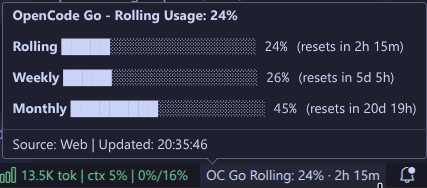

# OpenCode Go Monitor

<p align="center">
  
</p>

<p align="center">
  <a href="https://github.com/jorgealonsodev/opencode-go-monitor/releases"></a>
  <a href="LICENSE"></a>
</p>

A VSCode extension for real-time OpenCode Go quota monitoring in your status bar.

## Overview

**OpenCode Go Monitor** is a VS Code: extension that brings real-time quota visibility directly to your editor. Track your OpenCode Go usage without leaving your development environment, with API-key authentication, several named keys, historical trend prediction, and full bilingual support (English/Spanish).

## Features

- **Real-time Status Bar Monitoring**: Current usage percentage and reset countdown
- **API Key Authentication**: Reads quota from the OpenCode Go usage API with your Go API key
- **Several Named Keys**: Store one key per team or subscription and switch the monitored key in two clicks
- **Historical Tracking**: Local storage with linear regression exhaustion prediction
- **Bilingual Interface**: Automatic EN/ES detection based on VSCode locale
- **Rich Hover Tooltips**: Progress bars for Rolling, Weekly, and Monthly windows, plus the monitored key and last update time
- **Smart Interaction**: Single-click acts on the current state (refresh, add a key, or pick another key), double-click details
- **Secure Key Storage**: API keys live only in VSCode SecretStorage (OS Keychain)

## Screenshots



*Hover over the status bar item to see detailed progress bars for all three quota windows.*

## Installation

### From VSIX

1. Download the latest `.vsix` from [Releases](https://github.com/jorgealonsodev/opencode-go-monitor/releases)
2. Open VSCode
3. Go to Extensions view (`Ctrl+Shift+X` / `Cmd+Shift+X`)
4. Click `...` → **Install from VSIX...**
5. Select the downloaded file
6. Reload VSCode (`Ctrl+Shift+P` → `Developer: Reload Window`)

### From Source

```bash
git clone https://github.com/jorgealonsodev/opencode-go-monitor.git
cd opencode-go-monitor/opencode-go-monitor
npm install
npm run build
npm run package
```

## Quick Start

1. **Add an API key**:
   - Create or copy a key in the API keys section of the [OpenCode console](https://opencode.ai/console) (the workspace that holds your Go subscription)
   - `Ctrl+Shift+P` → `OpenCode Go: Add API Key` (or click `OC Go: add API key` in the status bar)
   - Enter a name (for example `Personal`) and paste the key

2. **Monitor**: The status bar will immediately show your current usage.

3. **Interact**:
   - **1 click**: Refresh quota (adds a key when none is set; picks another key when the current one is rejected)
   - **2 clicks**: Open detailed breakdown
   - **Hover**: See progress bars for all windows and a **Switch API key** link when you have several keys

4. **Several keys**: add more with `Add API Key`, then switch with `OpenCode Go: Select API Key`. With two or more keys the status bar shows the key name: `OC Go · Team 1 · Rolling: 42% · 2h 13m`.

> Upgrading from 0.1.x: browser-session setups (DevTools values and workspace ID) are no longer supported. Old credentials are removed on first start and you are asked to add an API key once; existing history is kept.

## Configuration

| Setting | Default | Description |
|---------|---------|-------------|
| `opencodeGoQuota.pollIntervalSeconds` | `300` | Poll frequency (min: 60s) |
| `opencodeGoQuota.warningThreshold` | `80` | Warning color threshold (%) |
| `opencodeGoQuota.errorThreshold` | `95` | Error color threshold (%) |
| `opencodeGoQuota.displayWindow` | `"rolling"` | `rolling`, `weekly`, or `monthly` |
| `opencodeGoQuota.debug` | `false` | Enable debug logging |

## Commands

| Command | Description |
|---------|-------------|
| `OpenCode Go: Add API Key` | Name and store a new API key |
| `OpenCode Go: Select API Key` | Choose which stored key is monitored |
| `OpenCode Go: Rename API Key` | Rename a stored key |
| `OpenCode Go: Replace API Key` | Paste a new value for a stored key |
| `OpenCode Go: Remove API Key` | Delete a stored key and its history |
| `OpenCode Go: Remove All API Keys` | Delete every stored key and all history |
| `OpenCode Go: Refresh Quota` | Force immediate quota fetch |
| `OpenCode Go: Show Details` | Open detailed breakdown QuickPick |
| `OpenCode Go: Export History` | Export the monitored key's history to JSON |
| `OpenCode Go: Open Dashboard` | Open OpenCode dashboard in browser |
| `OpenCode Go: Select Display Window` | Choose quota window to display |

## Project Structure

```
opencode-go-monitor/
├── opencode-go-monitor/          # VSCode Extension
│   ├── src/
│   │   ├── commands/           # VSCode command handlers
│   │   ├── domain/             # Core types, formatting, prediction
│   │   ├── fetchers/           # OpenCode Go usage API fetcher
│   │   ├── polling/            # Poll schedule, backoff and debounce
│   │   ├── storage/            # API key profiles and per-key history
│   │   ├── ui/                 # Status bar and QuickPick components
│   │   ├── i18n.ts             # Internationalization (EN/ES)
│   │   └── extension.ts        # Extension entry point
│   ├── test/                   # Unit tests
│   ├── package.json            # Extension manifest
│   ├── package.nls.json        # English translations
│   ├── package.nls.es.json     # Spanish translations
│   └── README.md               # Extension documentation
├── docs/prd/                    # Product requirements (PRD)
└── README.md                   # This file
```

## Security

This extension prioritizes security:

- **API keys**: Stored only in VSCode SecretStorage (OS Keychain: macOS Keychain, Windows Credential Manager, Linux Secret Service); never written to settings, logs, notifications, history or exports
- **Network**: HTTPS-only requests to `opencode.ai`; redirects are refused so the key is never sent elsewhere
- **No Telemetry**: Zero data collection or third-party tracking
- **No Dynamic Code**: Zero `eval()`, `Function()`, or dynamic code execution
- **Audit**: Comprehensive security audit performed; all critical findings resolved

## Development

```bash
# Install dependencies
cd opencode-go-monitor
npm install

# Compile TypeScript
npm run compile

# Run tests
npm test

# Build production bundle
npm run build

# Package as .vsix
npm run package
```

## Troubleshooting

### `OC Go: invalid key` in status bar

OpenCode rejected the monitored key (revoked or mistyped). Click the status bar to select another key, or run `OpenCode Go: Replace API Key`. Automatic polling for that key stops until then.

### `OC Go Rolling: limit` in status bar

The window's quota is exhausted; the countdown shows when it resets. This is not an error.

### Debug mode

Enable debug logging by setting `opencodeGoQuota.debug` to `true`. View logs in `View → Output → OpenCode Go Quota`.

## License

MIT

## Author

[jorgealonsodev](https://github.com/jorgealonsodev)
